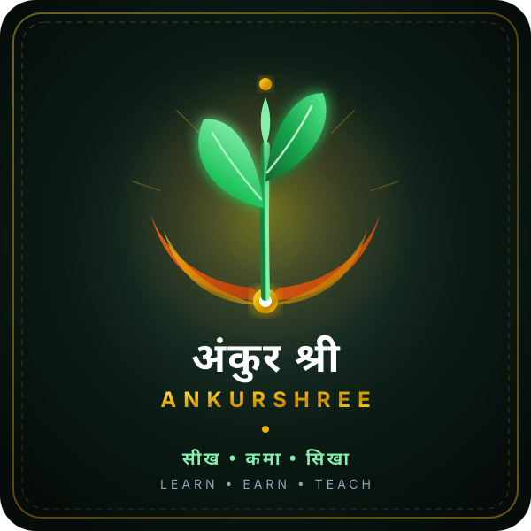

<p align="center">
  
  <br/>
  <strong>अंकुर श्री</strong>
  <br/>
  <em>सीख। कमा। सिखा। — Learn. Earn. Teach.</em>
</p>

<p align="center">
  <a href="#what-is-ankurshree">What</a> •
  <a href="#why-ankurshree">Why</a> •
  <a href="#how-it-works">How</a> •
  <a href="#the-six-pillars">Pillars</a> •
  <a href="#get-involved">Get Involved</a> •
  <a href="#roadmap">Roadmap</a> •
  <a href="#legal--compliance">Legal</a> •
  <a href="#license">License</a>
</p>

<p align="center">
  
  
  
  
</p>

---

## What is AnkurShree?

**AnkurShree** (अंकुर श्री — *The Auspicious Sprout of Prosperity*) is a community-powered social impact platform that connects underprivileged women and girls with **local mentors, skill training, education support, community funding, and employment pathways** — all while protecting their dignity, privacy, and safety.

> **This is NOT a charity app. This is a self-reliance engine.**
> 
> No handouts. No sob stories. No compromising dignity.
> 
> A woman learns a skill from a local mentor → starts earning → completes her education → starts her business or gets employed → then teaches the next woman.
> 
> **The cycle never stops.**

```
    🌱 SEED          🪴 SPROUT         🌳 TREE           🌱 NEW SEED
    ─────────       ─────────        ─────────         ─────────
    She learns      She earns        She grows          She teaches
    a skill         her first        her business       the next
    from a local    income within    or career          woman
    mentor          1-3 months                          
                                                       THE CYCLE
    ◀──────────────────────────────────────────────────── REPEATS
```

---

## Why AnkurShree?

### The Problem

| Reality | Numbers |
|---------|---------|
| India's female labour force participation rate | **~37%** — among the lowest globally |
| Women wanting to work but lacking skills/access | **Millions** — especially in Tier 2/3/4 cities and rural India |
| Existing skill platforms assume | Smartphone fluency, internet access, English, and self-learning ability — most vulnerable women have none of these |
| Charity model creates | **Dependency**, not independence |
| Personal data exposure on funding platforms | Opens women to **harassment, exploitation, and loss of dignity** |

### The AnkurShree Difference

| Traditional Approach | AnkurShree Approach |
|---|---|
| Give her money | **Teach her to earn money** |
| Online courses she'll never complete | **Local mentor teaches her in person** |
| One-time help | **Circular chain** — she learns, earns, then teaches another |
| Expose her identity to donors | **Anonymized Impact Profiles** — funders never see her real name or photo |
| Teach theory | **Speed to first income** — learn 30%, start earning, master over time |
| Either education OR employment | **Both simultaneously** — earn while completing evening college |

---

## How It Works

### For a Woman Seeking Skills (The Learner)

```
Step 1: Sign up on the app (basic details, verified by field partner)
Step 2: Choose a track:
        🅰 Skill → Earn (fastest path to income)
        🅱 Skill + Evening College (earn while getting a degree)
        🅲 Skill → Start Business (entrepreneurship path)
Step 3: Get matched with a LOCAL mentor in her area
Step 4: Learn IN PERSON at mentor's workshop/shop/home
Step 5: Mentor helps her find first customers or job
Step 6: Start earning within 1-3 months
Step 7: When ready, teach the next woman → THE CHAIN CONTINUES
```

### For a Mentor (The Guide)

```
Step 1: Register as a mentor (tailor, beautician, baker, teacher, retired professional, etc.)
Step 2: Get matched with learners in your locality
Step 3: Teach your skill in person — at your own shop/home/community center
Step 4: Help your learner find her first income (overflow orders, job referrals, client intros)
Step 5: Earn platform recognition, badges, and priority access to business support
```

### For a Funder (The Supporter)

```
Step 1: Browse anonymized "Impact Cards" — skill track, progress score, district, amount needed
Step 2: Fund fully or partially (₹100 minimum) — semester fees, skill materials, equipment
Step 3: Funds go DIRECTLY to institutions/vendors — NEVER as cash to beneficiary
Step 4: Track impact via progress dashboard (anonymized metrics)
Step 5: Get 80G tax receipt for donations
```

> **Important:** Funders NEVER see the learner's real name, photo, or exact location. All communication is platform-mediated. Zero direct contact.

---

## The Six Pillars

### 📚 Pillar 1: Hunar Hub (Skill Academy)

**Offline, mentor-based skill learning** — the platform connects, not teaches.

| Tier | What She Learns | Goal |
|------|----------------|------|
| **Foundation (Free)** | Reading, writing, communication, digital literacy, bargaining, confidence, self-defense awareness | Be functional and confident |
| **Vocational (Funded)** | Tailoring, beauty, cooking, data entry, freelancing, client handling, pricing | Start earning |
| **Entrepreneurship** | Business registration, GST, suppliers, hiring, scaling | Run her own venture |

### 🎓 Pillar 2: Padhai Path (Education Bridge)

- Partnerships with **IGNOU, NIOS, state open universities, evening colleges**
- Fund **only current semester** — so more women benefit
- **Performance-gated**: 60% attendance + passing grades required to continue
- Degree helps with formal employment where industries still require it for freshers

### 💰 Pillar 3: Sahyog Circle (Community Funding)

- Funders see **anonymized Impact Cards**, never personal identity
- Funds go to **institutions/vendors directly** — never as cash
- **Milestone-based release** — funds unlock per module/semester completion
- Sources: local donors, NRIs, CSR (mandatory 2% of corporate profit), government grants, FCRA foreign donations

### 🏢 Pillar 4: Udyam Shakti (Business Launchpad)

- Micro-loans via **MUDRA Yojana** (₹50K–₹10L, collateral-free)
- Conditions: GST registration, verified vendor purchases, monthly reporting
- **Hire-from-skill-pool incentive**: Hire a platform learner → your loan interest is reduced/waived
- This creates a **self-sustaining employment ecosystem**

### 🔒 Pillar 5: Suraksha Shield (Privacy & Safety)

- Full **DPDP Act 2023** compliance
- **Anonymized profiles** — system-generated alias + avatar, district-level location only
- **Zero direct funder-beneficiary contact** — all communication platform-mediated
- Encrypted KYC vault, breach notification protocol, grievance redressal officer
- Parental consent mechanism for minors (<18)
- Non-compliance penalty: **up to ₹250 Crore**

### 🤝 Pillar 6: Sarkari Setu (Government Partnerships)

- **PMKVY / NSDC** for officially recognized skill certification
- **MUDRA Yojana** for micro-business loans
- **SEBI Social Stock Exchange** for raising impact capital
- **SHG (Self-Help Group)** integration as grassroots trust network
- **Section 80G / 12A** for tax-deductible donations
- Convergence with Beti Bachao Beti Padhao, Stand-Up India, DAY-NRLM

---

## The Give-Back Chain

This is the soul of AnkurShree:

```
┌─────────────────────────────────────────────────────────────────┐
│                                                                 │
│    LEARNER ───▶ EARNER ───▶ MENTOR ───▶ EMPLOYER ───▶ FUNDER   │
│       │                                                  │      │
│       └──────────────── THE CYCLE ◀──────────────────────┘      │
│                                                                 │
│    She learns     She earns    She teaches    She hires    She  │
│    from a         within       the next       from the     funds│
│    local mentor   1-3 months   woman          skill pool   the  │
│                                                            next │
│                                                                 │
│    "What you learn should go back to the community"             │
│                                                                 │
└─────────────────────────────────────────────────────────────────┘
```

**Incentives for giving back:**
- 🏅 "Community Builder" badge on profile
- 🏦 Priority access to business loans
- 💰 Loan interest waiver for teaching 3+ women
- 📢 Featured in anonymized impact stories

---

## Revenue & Sustainability

> Revenue is not the priority. But running this without going bankrupt IS.

| Phase | Timeline | Revenue Streams | Target |
|-------|----------|----------------|--------|
| **🟢 Survival** | Year 1 | Donation platform fee (3-5%), CSR partnerships, government grants, FCRA foreign grants, recurring micro-donations | ₹15–30L/year |
| **🟡 Stability** | Year 2 | + Employer job listing fees, placement fees, marketplace commission, skill material sales, corporate training pipeline | ₹50L–1.5Cr/year |
| **🔵 Sustainability** | Year 3+ | + Micro-loan facilitation spread, SaaS licensing, SEBI SSE fundraising, brand partnerships, franchise model | ₹2–10Cr/year |

**Why it won't go bankrupt:**
- No classrooms to rent (mentors teach at their own place)
- No teachers to pay salary (community mentors)
- CSR spending is **legally mandatory** — ₹25,000Cr+ pool available annually
- Give-back chain = free mentors at scale
- Year 1 needs only 4 people: 1 founder + 1 tech + 1 field coordinator + 1 part-time CA

---

## Roadmap

```
Phase 1: FOUNDATION (Month 1-3)
├── Legal entity registration (Section 8 Company / Trust)
├── 80G / 12A / FCRA applications
├── MVP app development (Android, Hindi + 1 regional language)
├── Identify 3 pilot districts
└── Recruit first 10 mentors through local NGO/SHG partners

Phase 2: PILOT (Month 4-9)
├── Onboard first 50 learners in pilot districts
├── Launch community funding with anonymized Impact Cards
├── First CSR partnership (1-2 corporates)
├── First government scheme integration (PMKVY certification)
└── Iterate based on ground feedback

Phase 3: GROW (Month 10-18)
├── Expand to 10 districts
├── Launch Women's Job Board
├── First business loans facilitated (MUDRA partnership)
├── 500+ active learners, 50+ mentors
└── First "give-back" graduates become mentors

Phase 4: SCALE (Month 18-36)
├── Multi-state expansion
├── SEBI SSE registration exploration
├── SaaS licensing to partner organizations
├── 5,000+ women impacted
└── Platform becomes self-sustaining
```

---

## Tech Stack (Planned)

| Component | Choice | Rationale |
|-----------|--------|-----------|
| **Mobile App** | Android-first (React Native / Flutter) | 95%+ of target users are on Android |
| **Offline Support** | Local-first architecture | Intermittent internet in rural India |
| **Languages** | Hindi + English + regional (progressive) | Multi-lingual from day 1 |
| **Backend** | Node.js / Python + PostgreSQL | Cost-effective, well-supported |
| **Hosting** | AWS / GCP (non-profit credits) | Google.org and AWS offer free credits for social impact |
| **Payments** | Razorpay / Cashfree | UPI + card + netbanking + international |
| **KYC** | Aadhaar eKYC (encrypted vault) | Government-grade identity verification |
| **Analytics** | Anonymized impact dashboards | Privacy-preserving progress tracking |

---

## Legal & Compliance

| Requirement | Status | Details |
|-------------|--------|---------|
| DPDP Act 2023 | 📋 Planned | Data protection, consent management, breach notification |
| Section 8 Company / Trust Registration | 📋 Planned | Legal entity for non-profit social enterprise |
| 80G Registration | 📋 Planned | Tax deduction for donors |
| 12A Registration | 📋 Planned | Income tax exemption for the organization |
| FCRA License | 📋 Planned | Required for receiving foreign donations |
| SEBI SSE Registration | 🔮 Future | For large-scale public fundraising |
| GST Registration | 📋 Planned | For marketplace and service transactions |
| IT Act 2000 Compliance | 📋 Planned | Cybersecurity and data storage |

---

## Get Involved

### 🤝 I Want to Help Build This

We need people with skills in:
- **Mobile app development** (React Native / Flutter)
- **UI/UX design** (designing for first-time smartphone users)
- **Backend development** (Node.js / Python)
- **Legal & compliance** (Indian data protection, NGO registration)
- **Field operations** (connecting with SHGs, NGOs, Anganwadi networks)
- **Content** (writing skill curriculum in simple Hindi)
- **Finance** (CSR partnerships, grant writing, fundraising)

📧 **Reach out:** [Add your contact email]
💬 **Discussions:** [GitHub Discussions link]

### 💰 I Want to Fund / Partner

If you're a:
- **CSR team** looking for impact investment channels
- **Foundation** supporting women's empowerment
- **NRI** wanting to give back to Bharat
- **Government official** interested in convergence with existing schemes

📧 **Contact:** [Add your contact email]

### 🧑‍🏫 I Want to Mentor

If you have a skill and time to teach — even one woman, even one hour a week:

📧 **Register interest:** [Add your contact email]

---

## Philosophy

> **"Teach a woman to fish" > "Give a woman a fish"**

- 🪷 **Dignity first** — No poverty porn. No sob stories for funding. No exploitation of vulnerability.
- 🔒 **Privacy by design** — Every identity protected. Every rupee tracked. Every milestone verified.
- 📱 **Bharat first** — Works on ₹5,000 phones, in Hindi, with bad internet, for first-time users.
- 🔄 **Circular** — Today's learner → Tomorrow's earner → Future mentor → Next generation's funder.
- 🏗️ **Sustainable** — Not dependent on perpetual donations. Self-sustaining by Year 3.
- 🤝 **Of the People, By the People, For the People** — Community teaches community. India builds India.

---

## Name Meaning

| Part | Language | Meaning |
|------|----------|---------|
| **अंकुर (Ankur)** | Sanskrit / Hindi | Sprout, seedling — the first sign of life breaking through soil |
| **श्री (Shree)** | Sanskrit | Prosperity, dignity, auspiciousness, Goddess Lakshmi |

**AnkurShree = The Auspicious Sprout of Prosperity**

> *A seed of potential, treated with dignity, growing into prosperity.*

---

## License

This project is licensed under the [GNU Affero General Public License v3.0 (AGPL-3.0)](LICENSE) — ensuring the platform remains open-source and community-owned.

---

## Acknowledgments

- Inspired by the viral "Billionaire Tinder" concept — reimagined for Indian ground reality
- Built on the principles of India's Self-Help Group movement
- Aligned with Skill India Mission and Aatmanirbhar Bharat vision

---

<p align="center">
  <strong>अंकुर श्री — AnkurShree</strong>
  <br/>
  <em>सीख। कमा। सिखा।</em>
  <br/>
  <em>Learn. Earn. Teach.</em>
  <br/><br/>
  🌱 Every sprout deserves its sunlight 🌱
</p>
